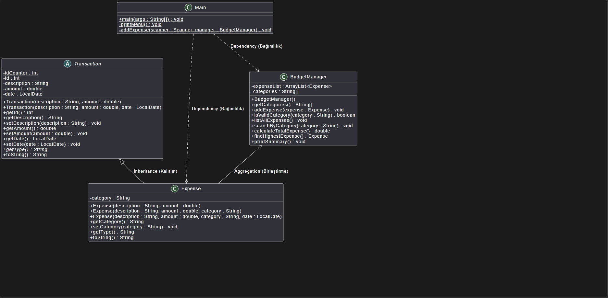

# Personal Budget Manager (Java OOP)

A modular, console-based personal expense and budget tracking application developed in **Java**, designed to showcase clean software design and core **Object-Oriented Programming (OOP)** principles.

## 📌 Architecture & OOP Concepts
- **Abstraction:** Implemented an abstract base class `Transaction` enforcing common transaction interfaces (`getType()`, timestamping, ID auto-increment).
- **Inheritance & Polymorphism:** Derived `Expense` class extending `Transaction` with custom category mappings and overridden string representations.
- **Encapsulation:** Robust data hiding with private fields, defensive getters/setters, and strict validation (e.g., non-negative amounts, mandatory descriptions).
- **Robust Error Handling:** Integrated exception handling for input mismatches (`InputMismatchException`, `NumberFormatException`) to prevent unexpected crashes.

## 📊 UML Class Diagram


## 🚀 Features
1. Add categorized expenses (`Food`, `Transport`, `Utilities`, `Entertainment`, `Other`).
2. List all recorded transactions with dynamic formatting.
3. Category-based expense search & filtering.
4. Financial summaries: Total expenditure and highest single expense detection.

## 🛠️ How to Run
```bash
javac budgetmanager/*.java
java budgetmanager.Main
